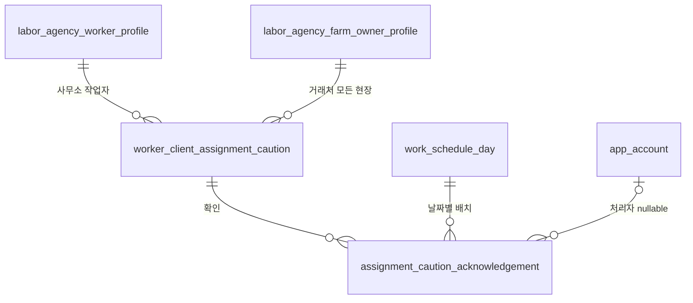

# 작업자·거래처 배치 주의 저장 구조

2026-10-11, `dev` 시작 커밋 `5b433f3` 이후 migration `035` 스냅샷.
API·화면 사용 중이며 배치 금지 제안과 별개다. 운영 DB 적용 여부는 확인하지 않았다.
요청·응답은 [API 문서](../api/assignment-cautions.md)를 참고한다.

## worker_client_assignment_caution

| 컬럼 | 타입·null·기본값·제약 |
|---|---|
| uuid | uuid PK NN DEFAULT gen_random_uuid() |
| agency_owner_uuid | uuid NN, 사무소 FK CASCADE |
| worker_profile_uuid | uuid NN, 같은 사무소 작업자 프로필 복합 FK CASCADE |
| client_profile_uuid | uuid NN, 같은 사무소 거래처 프로필 복합 FK CASCADE |
| requested_by | varchar(16) NN CHECK CLIENT/WORKER/BOTH |
| memo | varchar(500) nullable, null 또는 공백 아닌 값 CHECK |
| created_by_account_uuid, updated_by_account_uuid | uuid nullable, app_account FK SET NULL |
| created_at, updated_at | timestamptz NN DEFAULT now() |
| deleted_at | timestamptz nullable, 해제 시각 |

활성은 deleted_at IS NULL이다. 사무소/작업자/거래처 부분 UNIQUE가 중복을 막으며 작업자별 조회도 지원한다.
사무소/거래처 부분 인덱스도 있다. set_updated_at 트리거가 UPDATE 시각을 갱신한다.
중복 등록은 DO NOTHING 후 기존 관계를 읽어 사유·시각을 변경하지 않는다.
수정은 기존 행 갱신, 해제는 deleted_at/수정 주체 갱신, 재등록은 새 행이다.
별도 관계 수정 리비전은 없으므로 과거 사유의 모든 수정 버전을 재현하지 못한다.
migration 035는 거래처 프로필에 `(agency_owner_uuid, uuid)` UNIQUE를 추가한다.
작업자는 032의 UNIQUE를 재사용한다. 두 복합 FK가 타 사무소 조합을 DB에서도 거부한다.
중앙 worker/farm_owner나 숙련도·기존 배정은 관계 관리 시 변경하지 않는다.

2026-10-23 저장 방식 변경(스키마 변화 없음): 작업자 수정창의 관계 추가·수정·해제는 브라우저 초안이다.
오른쪽 위 저장에서 `WorkforceService.updateWorkerProfile`이 `AssignmentCautionService.applyWorkerChanges`를 호출해
변경된 관계만 기존 작업자 수정 트랜잭션에 포함한다. 실패는 해당 작업자 수정 전체를 롤백한다.
미변경 관계 전체를 교체하지 않으며 창을 열거나 취소하는 것만으로 DB에 기록하지 않는다.
거래처 화면의 독립 관계 저장·해제는 기존 즉시 반영 방식이다.

## assignment_caution_acknowledgement

| 컬럼 | 타입·null·기본값·제약 |
|---|---|
| uuid | uuid PK NN DEFAULT gen_random_uuid() |
| agency_owner_uuid | uuid NN, 사무소 FK RESTRICT |
| caution_uuid | uuid NN, 주의 관계 FK RESTRICT |
| caution_updated_at | timestamptz NN, 확인한 관계 버전 |
| schedule_day_uuid | uuid NN, 날짜별 일정 FK RESTRICT |
| acknowledged_by_account_uuid | uuid nullable, 계정 FK SET NULL |
| action | varchar(32) NN CHECK ASSIGNMENT_SAVE/NO_SHOW_REPLACEMENT |
| created_at | timestamptz NN DEFAULT now() |

사무소/일정/시각 DESC 인덱스. soft delete와 수정 트리거는 없다. 사유 원문은 복제하지 않는다.
사무소와 관계/일정의 일치 여부는 Service에서 검증하며 개별 FK만으로 복합 범위가 보장되지는 않는다.
API 확인 기록 조회 화면은 없다. 기록 존재는 다음 배치 확인을 면제하지 않는다.
감사가 남은 관계/부모의 물리 삭제는 RESTRICT에 막힐 수 있다. 앱의 soft delete와 별도 규칙이다.

실제 FK만 표시했다. 대상 현장은 일정의 ownerUuid와 사무소 거래처 프로필을 통해 연결한다.
활성 관계를 FOR SHARE로 읽어 같은 배치 트랜잭션 동안 이미 읽은 사유가 수정되지 않게 한다.
관계 없음 조회와 동시 신규 등록 사이의 모든 phantom race를 차단한다고 주장하지 않는다.
이미 배치된 뒤 관계를 등록해도 자동 취소하지 않고 재조회 시 현재 주의 표시만 바뀐다.

드롭(주의 대상은 확인한 뒤)은 초안만 바꾼다. 체크 저장 시 ScheduleService.updateTask의 movedWorkerProfileUuids가
해당 사무소/날짜 일정 행을 UUID 순서로 잠그고 대상 저장과 원배정 제거·확인 기록을 같은 트랜잭션에서 처리한다.
실패하면 원배정 제거도 롤백된다. 원작업의 일정 내용·근태·익명 인원은 변경하지 않는다.
다른 모든 일반 PUT/익명 배치/근태 경로가 같은 일정 행 잠금을 사용하는 것은 아니다.
실제 SQL 근거: `cautions/dao/JdbcAssignmentCautionDao`의 findActive/create/update/release/recordAcknowledgement,
`schedule/dao/JdbcScheduleDao.lockScheduleDays/replaceAssignments/removeTransferredAssignments`.
업무 근거: `cautions/application/AssignmentCautionService`, `schedule/application/ScheduleService`.

## 한계

- 현재 loginId 계정 조회는 사칭 방지 인증이 아니다. 이 기능이 기존 인증 한계를 해결하지 않는다.
- 익명·신원 없는 동행 인원은 개별 관계를 검사할 수 없다.
- 관리 수정 이력 전체, 과거 경고 재현, 확인 로그 조회 화면, 요청 ID 기반 exactly-once는 이번 범위 밖이다.
- 스키마나 저장 흐름이 바뀌면 이 문서와 API 문서를 함께 갱신한다.

## 검증 방법

`.skills/verify-core.ps1`은 Service/MockMvc 회귀 테스트를 고객 DB 연결 없이 실행한다.
`.skills/verify-assignment-cautions.ps1`(Linux: 동일 이름 `.sh`)은 Docker의 로컬 `postgres:18` 이미지가 필요하다.
전용 임시 컨테이너에 최소 부모 스키마와 실제 migration 035를 적용해 부분 UNIQUE, 사무소 복합 FK,
주체/메모 CHECK, 수정 시각, 해제 후 재등록, 확인 기록 보존을 검사한다. DAO의 실제 중복 INSERT SQL을 재사용한다.
원배정 제거 SQL도 재사용해 옮긴 인원만 소프트 삭제되고 다른 배정의 상태·인원, 익명/REPLACED/타 사무소/대상 배정은 유지되는지 검사한다.
호스트 포트/고객 볼륨/외부 네트워크를 연결하지 않고 마지막에 임시 컨테이너와 볼륨을 정리한다.
전체 001~035 업그레이드나 실제 Spring+DB 이동 트랜잭션의 통합 검증을 대신하지는 않는다.
