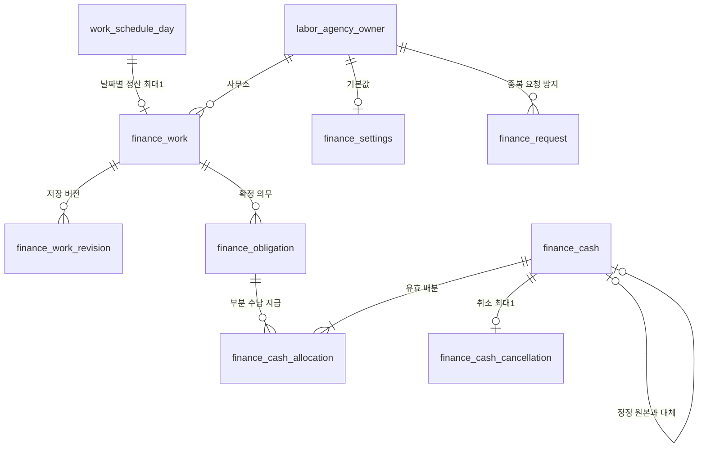

# 수익·정산 저장 구조

2026-10-25 migration `036_create_finance_ledger.sql` 기준. 개발 중 스냅샷이며 운영 DB 적용 여부는 별도다.
[API](../api/finance.md) · [정책·사용 절차](../product/finance-policies.md)

## 기존 기반과 구분

기존 `work_schedule_assignment_pay_term`은 약정 단가, `attendance_settlement_period`는 근태 기간의 기반이다.
현재 사용 코드가 없고 부분 수납·지급·배분·정정 원장이 아니므로 이번 기능으로 의미를 바꾸거나 값을 자동 이전하지 않는다.
새 finance 테이블이 실제 사용자 기능에 연결되고 기존 두 테이블은 계속 DB-only로 남는다.
정산 원천은 날짜별 `work_schedule_day`와 개별 `work_schedule_assignment`, 확인된 `worker_attendance_record`다.
익명의 participant_group_uuid는 묶음이며 개인 수령자 식별자가 아니다. 익명 정산 키는 개별 배정 UUID다.

## 테이블

### finance_work

- uuid uuid PK DEFAULT gen_random_uuid(), agency_owner_uuid NN → labor_agency_owner RESTRICT.
- schedule_day_uuid NN UNIQUE → work_schedule_day RESTRICT, site_uuid NN → farm_work_site RESTRICT.
- client_uuid NN → 중앙 farm_owner RESTRICT, client_profile_uuid nullable → 사무소 거래처 프로필 RESTRICT.
- version bigint NN >=1, status DRAFT/CONFIRMED, work_date date NN, snapshot jsonb NN, ever_confirmed boolean DEFAULT false, created_at timestamptz DEFAULT now().
- (agency_owner_uuid,uuid) UNIQUE 및 사무소/작업일 인덱스. 정산은 날짜별 일정당 1건이다.
- snapshot은 당시 표시명, 지급 주체, 금액, 실제 근태 근거, 원천 fingerprint, 예정일을 보존한다.
- GET은 생성하지 않고 명시적 prepare에서 DRAFT 생성. 같은 날짜 재호출은 기존 기록을 유지한다.

### finance_work_revision

- (work_uuid,version) PK, work_uuid → finance_work RESTRICT.
- status DRAFT/CONFIRMED, 선택 reason varchar(1000), snapshot jsonb NN, changed_at timestamptz DEFAULT now(), changed_by_account_uuid NN → app_account RESTRICT.
- 초안/확정/정정 시 이전 버전을 보존한다. UPDATE/DELETE 금지 트리거가 있다.
- 사무소 범위는 연결 work를 통해 확인한다. 독립 agency 컬럼은 없다.

### finance_obligation

- uuid uuid PK DEFAULT, agency_owner_uuid NN → 사무소 RESTRICT, work_uuid와 사무소 복합 FK → finance_work RESTRICT.
- kind RECEIPT/PAYOUT/DIRECT, party_key varchar(80) NN, party_name varchar(250) NN, assignment_uuid nullable.
- amount numeric(18,0) NN CHECK 0..999999999999, original_due_date/due_date nullable date.
- (agency_owner_uuid,uuid), (work_uuid,kind,party_key) UNIQUE. 사무소/kind/예정일 인덱스.
- RECEIPT만 assignment_uuid null이고 나머지는 NN CHECK. assignment_uuid는 논리 연결이며 직접 FK가 아니다.
- 확정 시 청구·지급 의무를 upsert한다. 사라진 의무는 금액 0으로 남겨 기존 배분과 초과 정산을 확인할 수 있다.
- 현재 예정일을 바꿔도 최초 original_due_date는 덮어쓰지 않는다. 과거 값은 work revision에서도 확인한다.

### finance_cash

- uuid uuid PK DEFAULT, agency_owner_uuid NN → 사무소 RESTRICT, kind RECEIPT/PAYOUT/DIRECT.
- party_key varchar(80), cash_date date, amount numeric(18,0) CHECK 1..999999999999, method CASH/TRANSFER/OTHER, memo varchar(1000) nullable.
- created_at timestamptz DEFAULT now(), created_by_account_uuid NN → app_account RESTRICT.
- replaces_cash_uuid nullable → 같은 사무소 finance_cash 복합 FK RESTRICT, 대체 원본당 1개 부분 UNIQUE.
- (agency_owner_uuid,uuid) UNIQUE, 사무소/kind/기록일 인덱스. UPDATE/DELETE 금지.
- DIRECT는 농가 직접 지급 확인으로 사무소 현금 흐름에 합산하지 않는다. 실제 은행 처리는 없다.

### finance_cash_allocation

- (cash_uuid,obligation_uuid) PK, agency_owner_uuid NN.
- 사무소/cash, 사무소/obligation 복합 FK RESTRICT, amount numeric(18,0) CHECK 1..999999999999.
- obligation_uuid 인덱스. UPDATE/DELETE 금지.
- INSERT 트리거는 사무소 advisory lock과 의무 잠금을 사용해 kind/상대방 일치, 취소되지 않은 cash, 의무 잔액과 cash 잔액 이내를 검사한다.
- cash의 지연 제약 트리거는 트랜잭션 종료 시 배분 합계=현금 기록액을 검사한다.

### finance_cash_cancellation

- cash_uuid PK + 사무소 복합 FK → finance_cash RESTRICT.
- reason varchar(1000) NN 공백 금지, cancelled_at timestamptz DEFAULT now(), cancelled_by_account_uuid → app_account RESTRICT.
- 원본/배분은 변경하지 않고 활성 배분 합계에서 취소된 cash를 제외한다. 취소 자체도 UPDATE/DELETE 금지다.

### finance_request

- (agency_owner_uuid,request_id uuid) PK, 사무소 FK RESTRICT.
- payload_hash char(64), response jsonb NN, created_at timestamptz DEFAULT now(). UPDATE/DELETE 금지.
- 정규화한 의미 본문을 SHA-256으로 비교한다. 같은 키의 다른 본문은 거부하고 같은 본문은 저장된 결과를 반환한다.
- 현금 기록·배분·취소/정정과 같은 트랜잭션에서 저장한다. 실패한 작업은 재시도 키를 선점하지 않는다.

### finance_settings, finance_settings_revision

- settings: agency_owner_uuid PK/FK RESTRICT, version bigint>=1, settings jsonb NN.
- revision: (agency_owner_uuid,version) PK, settings jsonb, reason varchar(1000) NN, changed_by_account_uuid FK RESTRICT, changed_at DEFAULT now().
- JSON에 사무소/작업자/거래처 기본값과 지급 주기를 보관한다. 예외 프로필 소유권은 Service에서 확인한다.
- revision은 UPDATE/DELETE 금지, settings는 버전 조건으로 갱신한다. 과거 work snapshot은 설정 변경으로 바뀌지 않는다.

## 관계도

실제 FK만 표시했다. `snapshot.lines[].assignmentUuid`와 obligation.assignment_uuid는 배정에 대한 논리적 참조다.
cash는 실제 DB 제약으로 전액 배분되지만, 원천 근태·작업자 인식의 적합성은 Service 검증에 의존한다.

## 삭제와 원천 변경

- 확정 이력이 있는 날짜 일정·현장의 UPDATE/DELETE 트리거가 취소/소프트 삭제/물리 삭제를 거부한다.
- 배정 제거·근태 수정은 이력을 지우지 않고 원천 fingerprint의 변화로 금액 재확인을 표시한다.
- 중요한 날짜/명단/상태/실제시간/휴게/인원만 비교하고, 메모·프로필 표시명·확인 타임스탬프 변화는 불필요한 재확인을 만들지 않는다.
- 거래처/작업자 비활성화는 이미 저장된 스냅샷이나 돈 기록의 조회를 숨기지 않는다.
- 중앙 worker와 사무소 프로필은 별개다. 등록 정산 키는 사무소 프로필, 익명은 배정별 키이며 다른 사무소의 이력과 합치지 않는다.
- 최초 확정 이후 다른 거래처/현장/수령자로 자동 이관하지 않는다. 식별자 변경 시 기존 원장을 보존하고 사용자 조치가 필요하다.

## 검증과 한계

`.skills/verify-finance.ps1` / `.sh`는 로컬 postgres:18 이미지를 사용하는 전용 임시 컨테이너를 만든다.
무작위 DB명·표식 토큰을 확인한 JUnit만 해당 DB에 쓰며, 고객 DB 환경설정·볼륨을 읽지 않는다.
loopback 임의 포트만 열고 최소 부모 스키마+029/030/036/037을 적용한 뒤 지정 verify-core를 한 번 실행한다. 037 이후에는 노쇼 JDBC 회귀도 함께 실제 실행되었는지 검사한다.
같은 테스트 결과를 재사용하지 않도록 실행별 빌드 디렉터리와 실제 JUnit 실행/skip 검사를 사용하고, 마지막에 컨테이너·전용 볼륨을 제거한다.
전체 001~036의 운영 데이터 업그레이드 검증과 실제 인증/역할 인가·보안 검증은 대신하지 않는다.
현재 사무소 범위는 loginId 해석에 의존하므로 운영 출시는 실제 인증·권한이 마련될 때까지 차단 대상이다.
